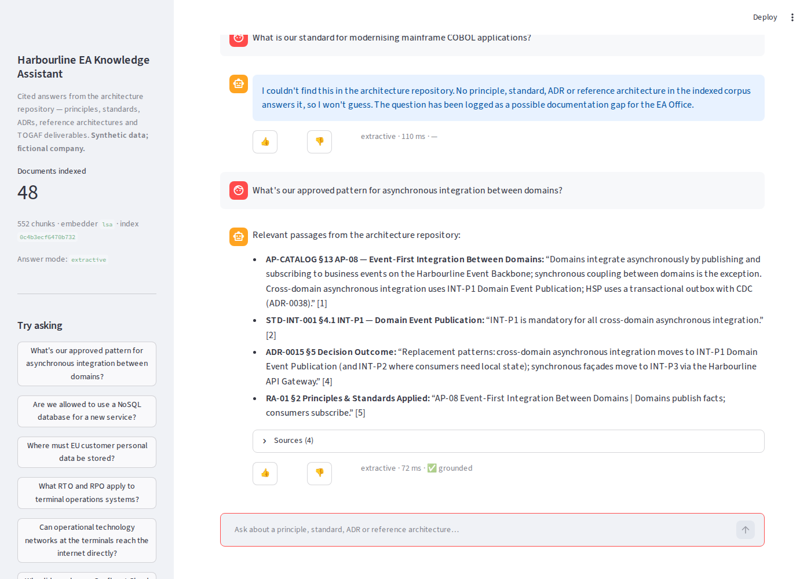
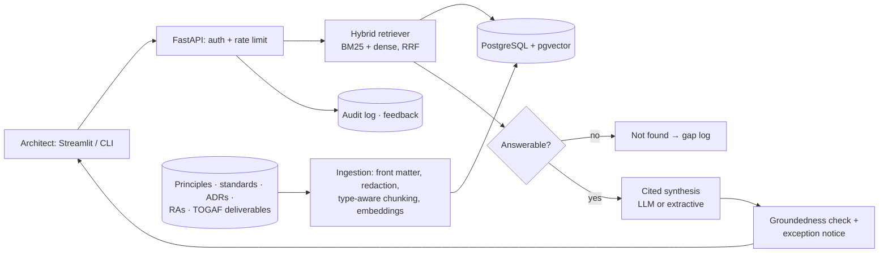
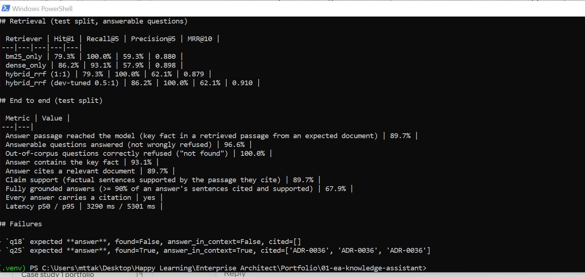

# EA Knowledge Assistant: RAG over the Architecture Repository

> Project 1 of the [Enterprise Architecture + AI Portfolio](../README.md) · Tier: Beginner · Status: **built, tested and evaluated** (offline configuration)

Architects keep re-asking questions that the repository already answers, such as *"are we allowed to
use NoSQL for this?"* or *"what's our approved async integration pattern?"*. Finding the answer takes
longer than asking a colleague. This assistant answers from the repository **only**. It cites the exact
document and clause behind each answer, and says **"not found"** instead of guessing.



## What's in this project

| | |
|---|---|
| **A realistic architecture repository** | 48 original documents (~66k words) for a fictional global freight and port-terminal operator, *Harbourline Logistics Group*: <br>• 16 principles, 15 standards, 12 ADRs and 4 reference architectures <br>• 13 deliverables following the TOGAF ADM structure: Architecture Vision, Statement of Architecture Work, Architecture Definition Document, requirements, roadmap, Architecture Contract, Compliance Assessment, Change Request and more <br>• An ARB charter, an Exceptions Register and a glossary <br>See [`data/README.md`](data/README.md). |
| **Retrieval pipeline** | Section-aware chunking by document type, so clauses are citable as `STD-INT-001 §4.1`, and ingestion-time redaction. Hybrid BM25 + dense retrieval fused with RRF, plus an answerability gate. |
| **Grounded answers** | Citation-forced prompt with a `NOT_FOUND` path, a post-generation groundedness check, and a governance notice on any question about architecture exceptions. |
| **Interfaces** | FastAPI (`/ask`, `/documents`, `/feedback`, `/health`) with API keys and rate limiting; Streamlit chat UI with 👍/👎 feedback; `eaka` CLI. |
| **Storage** | PostgreSQL + pgvector (docker-compose); an in-memory store for development and CI. |
| **Evidence** | 50-question hand-labelled evaluation with a dev/test split, 22 tests including a pgvector integration test, and GitHub Actions CI with an evaluation regression gate. |

## Architecture



The full design, including the chunking strategy, request flow and Azure/AWS deployment mapping, is in
[`docs/architecture.md`](docs/architecture.md). The design decisions are recorded in [`docs/adr/`](docs/adr).

## Quickstart

```bash
# Offline: no API keys, no database
pip install -e ".[ui,dev]"
eaka ask "Are we allowed to use a NoSQL database for a new service?"
streamlit run app/streamlit_app.py
pytest -q && python eval/run_eval.py

# Full stack: PostgreSQL + pgvector, API and UI
cp .env.example .env          # optional: set EAKA_LLM_PROVIDER + a key
docker compose up --build     # UI http://localhost:8501 · API docs http://localhost:8000/docs
```

To use an LLM, set `EAKA_LLM_PROVIDER` to `azure_openai`, `anthropic` or `openai` and supply the
matching key in `.env` (each provider has a ready block in `.env.example`), then run `eaka check` to
confirm the key, model and a test call before starting the UI. For an organisation with EU and UAE data-residency rules, the recommended
choice is **Azure OpenAI deployed in the data's own region**. The reasoning is in
[ADR-P003](docs/adr/ADR-P003-llm-and-embedding-provider.md).

## Example

The blueprint's example question is *"What's our approved pattern for asynchronous integration
between domains?"* The assistant returns:

- **Principle AP-08** (Event-First Integration Between Domains);
- **STD-INT-001 §4.1 INT-P1** Domain Event Publication, which is mandatory;
- the ADR that moves integrations off the ESB (ADR-0015);
- the reference architecture RA-01.

Each is cited by clause. For *"What is our standard for modernising mainframe COBOL applications?"* the
assistant refuses and logs the question as a documentation gap (see the screenshot above).

## Evaluation (held-out test split: 29 answerable + 7 out-of-corpus questions)

Retrieval is identical in both configurations: **Recall@5 100% · Hit@1 86.2% · MRR@10 0.910**
(hybrid, dev-tuned). Hybrid beats either retriever alone on MRR@10: BM25 0.880 · dense 0.898 ·
**hybrid 0.910**.

| Measure | Offline (extractive, no LLM) | With an LLM (Claude Haiku 4.5) |
|---|---|---|
| Out-of-corpus questions correctly refused | 6 of 7 | **7 of 7** |
| Answerable questions wrongly refused | **0 of 29** | 1 of 29 (q18) |
| Answer contains the key fact | 72.4% | **93.1%** |
| Answer cites a relevant document | 96.6% | 89.7% |
| Claim support (factual sentences supported by the passage they cite) | n/a (answers are quotes) | **89.7%** |
| Fully grounded answers (≥ 90% of sentences cited and supported) | 100% (by construction) | 67.9% |
| Answers carrying a citation or a "not found" | 100% | 100% |
| Latency p50 / p95 | 158 ms / 494 ms | 3.3 s / 5.3 s |



The LLM closes the key-fact gap and catches the out-of-corpus question that only uses in-corpus
vocabulary, which is what the second (`NOT_FOUND`) gate is for. The full reports are
[`eval/results/claude.md`](eval/results/claude.md) and
[`eval/results/offline_baseline.md`](eval/results/offline_baseline.md); method and metric
definitions are in [`eval/README.md`](eval/README.md).

**Known weak spots, stated rather than tuned away:**

- **q18** ("How is the Tidewater data platform organised into layers?") is wrongly refused. The
  medallion-layer passage in RA-04 doesn't reach the model because the offline LSA embedder confuses
  RA-04's similarly titled sections. Neural embeddings are the expected fix and haven't been measured
  yet.
- **q25** ("Why did we move off MPLS?") is counted as a miss, but the answer is correct and every
  sentence is supported. It names Fortinet rather than the rubric's keyword "SD-WAN". The rubric was
  left unchanged after seeing results, so 93.1% is slightly conservative.
- **Fully grounded 67.9% vs. claim support 89.7%:** most of the gap is short uncited framing lines
  (headings, one-line summaries) rather than unsupported facts.
- **An earlier run reported 37% groundedness.** Most of that was a bug in the checker, not the model:
  it counted headings as claims and mis-parsed multi-citation brackets like `[7, §4.1]`. The checker
  and retrieval fusion were fixed and covered by regression tests before these numbers were produced.

## Governance: what this system does not do

It doesn't author or amend standards, and it doesn't grant, renew or judge architecture exceptions.
Any answer touching an exception says that the ARB decides. Every answer cites its source or says
"not found". Every question is logged for audit, and unanswered questions feed the EA Office's
documentation backlog. The controls and limitations are set out in
[`docs/governance-and-limitations.md`](docs/governance-and-limitations.md).

## Repository layout

```
01-ea-knowledge-assistant/
├── src/eaka/            ingest · redact · lexical (BM25) · embeddings · store (memory/pgvector)
│                        retrieval · answer · engine · querylog · api · cli
├── app/                 Streamlit UI
├── data/corpus/         48-document synthetic architecture repository (+ data/README.md)
├── data/WORLD_BIBLE.md  shared facts about the fictional enterprise (reusable by Projects 2-10)
├── eval/                queries.yaml (50 labelled questions), run_eval.py, results/
├── tests/               ingestion, retrieval/answers, API, pgvector integration
├── docs/                architecture.md, governance-and-limitations.md, adr/ (ADR-P001…P005), images/
├── infra/Dockerfile · docker-compose.yml · Makefile · .env.example   (CI: ../.github/workflows/ea-knowledge-assistant.yml)
```

---
*All data is synthetic. Harbourline Logistics Group is fictional. TOGAF® is a registered trademark of The Open Group; no Open Group text is used.*
