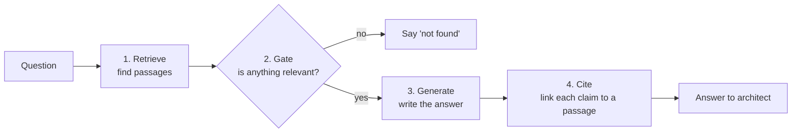
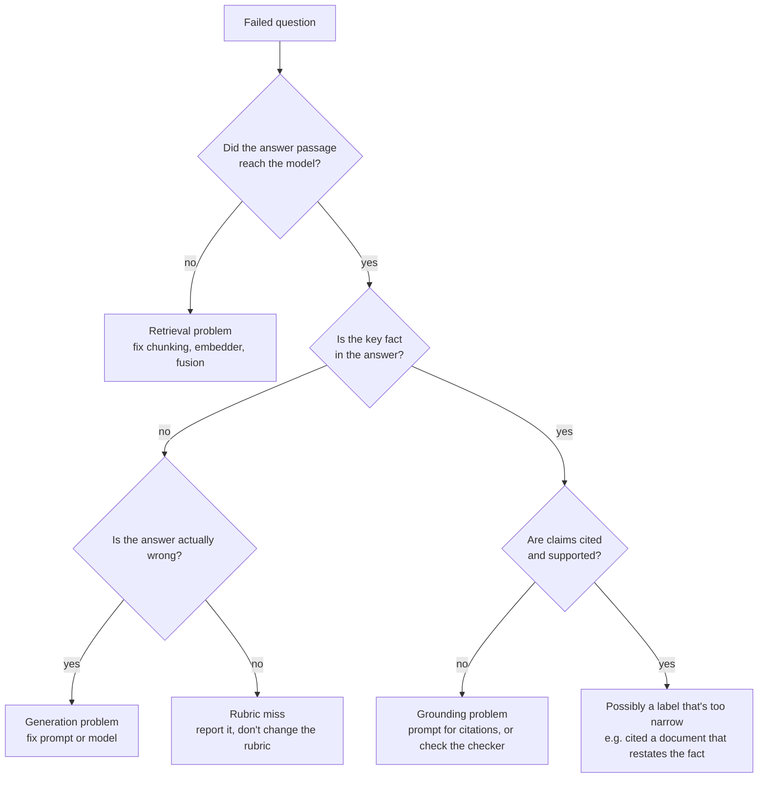

# How to evaluate a RAG assistant: a practical guide

This guide explains how the EA Knowledge Assistant was tested, why each test exists, and how to run
the same kind of evaluation on any retrieval-augmented generation (RAG) system. Every example and
number comes from this project's real runs.

**Where to look next:**

- [`results/claude_questions.md`](results/claude_questions.md): every test question, the assistant's answer, and which checks it passed (Claude Haiku 4.5).
- [`results/offline_baseline_questions.md`](results/offline_baseline_questions.md): the same questions with no LLM, as a baseline.
- [`README.md`](README.md): short summary of the method and results.

---

## 1. What "accuracy" means for a RAG system

A RAG assistant is a pipeline, and each stage can fail on its own. One "accuracy" number hides which
stage broke, so this evaluation measures each stage separately.



| Stage | What can go wrong | Example failure | Measured by |
|---|---|---|---|
| 1. Retrieve | The passage with the answer isn't found | Search returns the purpose section of RA-04 instead of the section describing its layers | Hit@1, Recall@5, Precision@5, MRR |
| 2. Gate | Answers a question it can't answer, or refuses one it can | Invents a "mainframe modernisation standard" that doesn't exist | Out-of-corpus refused, answerable answered |
| 3. Generate | Right passage, wrong or missing fact in the answer | Quotes a sentence *about* the MuleSoft freeze but not the date | Key fact in answer |
| 4. Cite | Claim is correct but not backed by what it cites, or not cited at all | "Another platform would need an ARB decision" with no source | Claim support, fully grounded |

The single most useful diagnostic is **"did the answer passage reach the model?"** If it didn't, the
failure is retrieval. If it did and the answer is still wrong, the failure is generation. That one
check tells you which half of the system to fix.

---

## 2. Step 1: build a labelled question set

The question set (`queries.yaml`) is the foundation. Every metric is only as good as these labels.

### What one labelled question looks like

```yaml
- id: q03
  split: test
  question: "Is it still OK to build new MuleSoft flows?"
  relevant_docs: [ADR-0015, STD-INT-001, STD-TLC-014]   # documents that genuinely answer it, primary first
  answer_keywords: ["2025-06-30|30 June 2025"]          # the fact a correct answer must contain
```

And an out-of-corpus question, which the assistant must refuse:

```yaml
- id: n02
  split: test
  expect: not_found
  question: "Can we use blockchain to issue electronic bills of lading?"
```

### How the set was designed

| Choice | What was done | Why it matters |
|---|---|---|
| Size | 50 questions: 40 answerable, 10 out of corpus | Enough to be indicative and to find patterns; small enough to label carefully by hand |
| Coverage | Questions across every domain: integration, data, cloud/security/network, resilience, AI, lifecycle/governance | A system that's great on one domain and weak on another should show it |
| Phrasing | Paraphrased the way an architect would ask, never copying section headings | Copying headings makes retrieval look perfect because the words match exactly ("keyword echo") |
| Key facts | One checkable fact per question: a date, product name, region or pattern ID, with alternatives separated by `|` | Makes correctness checkable by code instead of by opinion |
| Negatives | 10 questions on topics the corpus was deliberately written never to cover (mainframe, blockchain, travel policy, salary bands...) | The only way to measure whether the system says "not found" rather than guessing |
| Hard negatives | Some negatives sound in-corpus, e.g. "SAP S/4HANA version upgrade timeline" (SAP appears in the corpus, upgrade plans don't) | Easy negatives inflate the refusal score; hard ones test it |

**Tip:** write the out-of-corpus topics down *before* writing the corpus, then never mention them.
This project's world bible lists them as reserved topics. Without that discipline you can't be sure a
"negative" question really has no answer.

---

## 3. Step 2: split into dev and test

| Split | Size | Used for |
|---|---|---|
| dev | 14 (11 answerable, 3 out of corpus) | Choosing settings: the retrieval fusion weight and the "not found" threshold |
| test | 36 (29 answerable, 7 out of corpus) | Every reported number |

**Why:** if you tune a setting on the same questions you report on, the score measures how well you
tuned, not how well the system works on new questions. This is the same idea as a train/test split in
machine learning. Here the "training" is only two numbers, but the leak would still be real.

What the dev split chose in this project:

- **Fusion weight 0.5:1** (lexical:dense). Dev MRR was 0.939 at 0.5, versus 0.879 at 1.0 to 1.5.
- **Not-found threshold 0.51.** It maximises balanced accuracy on dev, then sits in the middle of the widest gap between answerable and out-of-corpus scores. That way the boundary isn't hugging either group.

---

## 4. Step 3: check the labels before scoring

Before computing anything, the harness checks that:

1. every document named in `relevant_docs` exists in the index, and
2. the primary document really contains the expected key fact.

This catches typos in labels and questions whose "right answer" isn't actually in the corpus. A
broken label silently counts as a system failure, so this check protects the score from your own
mistakes. This run reported zero label problems.

---

## 5. Step 4: measure retrieval

Retrieval is measured on its own, before any answer is written. A retrieved passage counts as
relevant if it comes from a labelled document.

| Metric | Plain meaning | Formula |
|---|---|---|
| **Hit@1** | Was the very first result relevant? | share of questions where rank 1 is relevant |
| **Recall@5** | Was at least one relevant passage in the top 5? | share of questions with a relevant passage in the top 5 |
| **Precision@5** | How much of the top 5 was relevant? | relevant passages in top 5 / 5, averaged |
| **MRR@10** | How high is the first relevant passage, on average? | mean of 1/rank of the first relevant result (0 if none in the top 10) |

### Worked MRR example

| Question | Rank of first relevant passage | 1/rank |
|---|---|---|
| A | 1 | 1.00 |
| B | 2 | 0.50 |
| C | 1 | 1.00 |
| D | 4 | 0.25 |

MRR = (1.00 + 0.50 + 1.00 + 0.25) / 4 = **0.69**. An MRR of 0.910 means the first relevant passage is
usually at rank 1, occasionally at rank 2.

### Always compare against baselines

A number alone says little. The harness runs four retrievers on the same questions:

| Retriever | Hit@1 | Recall@5 | MRR@10 |
|---|---|---|---|
| BM25 only (keyword) | 79.3% | 100.0% | 0.880 |
| Dense only (LSA vectors) | 86.2% | 93.1% | 0.898 |
| Hybrid RRF, equal weights | 79.3% | 100.0% | 0.879 |
| **Hybrid RRF, dev-tuned 0.5:1** | **86.2%** | **100.0%** | **0.910** |

This is what justifies the design: hybrid keeps keyword search's recall (dense alone misses 7%) and
gets dense search's ranking. Comparing variants like this, one change at a time, is called an
**ablation**. It's how you prove a component earns its place.

**Caveat worth knowing:** these metrics are *document-level*. Question q18 has its labelled document
(RA-04) at rank 1, but the retrieved section is the purpose statement, not the section with the
answer. That's why the end-to-end check in section 8 also asks whether the passage containing the fact
reached the model.

---

## 6. Step 5: measure refusal behaviour (both directions)

A system that refuses everything never hallucinates. A system that answers everything never wrongly
refuses. Both are useless, so you measure both directions together.

| Metric | Offline | Claude Haiku 4.5 |
|---|---|---|
| Out-of-corpus questions refused | 6 of 7 (86%) | **7 of 7 (100%)** |
| Answerable questions answered (not wrongly refused) | 100% | 96.6% (q18 refused) |

**Two gates, and why.** The first gate is a retrieval score threshold. It cannot catch n09 ("SAP
S/4HANA version upgrade timeline") because every word in that question appears in the corpus, so the
scores look confident. The second gate is an instruction to the LLM to reply `NOT_FOUND` when the
passages don't answer the question. In the LLM run that second gate catches n09. Defence in depth
applies to AI behaviour as much as to security.

---

## 7. Step 6: measure answer correctness

**Method:** check whether the answer text contains the labelled key fact (case-insensitive, any
alternative accepted). For q14 ("Where must EU customer personal data be stored?") the answer must
contain `West Europe`.

| Run | Key fact in answer |
|---|---|
| Offline (extractive quoting) | 72.4% |
| Claude Haiku 4.5 | **93.1%** |

**Strengths:** objective, cheap, repeatable, needs no second model.
**Weakness:** it can mark a correct answer wrong if it's phrased differently. q25 explains *why we
moved off MPLS* correctly but never writes the literal term "SD-WAN", so it fails the rubric.

**The rule that keeps this honest:** the rubric was not changed after seeing that result. Loosening a
rubric only for the answers that failed is grading to the answer. It inflates the score and teaches
you nothing. Report the miss and explain it instead.

**Alternatives you could add** (and when they're worth it):

| Method | Good for | Cost and risk |
|---|---|---|
| Keyword/fact rubric (used here) | Facts with an exact form: dates, IDs, product names | Misses paraphrases |
| LLM-as-judge | Open-ended answers ("explain the trade-offs") | The judge can be wrong or biased; you need to check it against human labels |
| Human review | Final confidence, small samples | Slow; reviewers disagree, so measure their agreement |

---

## 8. Step 7: measure groundedness (are claims backed by citations?)

Correct is not enough for an architecture assistant. An architect must be able to click a citation
and see the rule. Groundedness checks that every claim is supported by the passage it cites.

**How the checker works** (`eaka.answer.check_groundedness`):

1. Split the answer into claim units: sentences, with each bullet point treated as one claim. Headings, labels and short lead-ins are skipped.
2. For each claim, read its citation numbers, e.g. `[2]` or `[1][3]`.
3. If there's no citation, the claim is **unsupported**.
4. Otherwise, compare content words: at least **50%** of the claim's words must appear in the cited passage.
5. **Claim support** = supported claims / all claims, pooled across answers.
6. An answer is **fully grounded** if at least **90%** of its claims are supported and no citation number is invalid.

### Worked example (q08)

> "This approach decouples portal availability from HSP ... while keeping HSP as the single system of record [2][4]."

Word overlap with passages 2 and 4 was **0.47**, just under the 0.50 cut-off, so the checker rejected
it. The claim is accurate, but it's a loose paraphrase. That's the nature of a word-overlap heuristic:
it's strict and transparent, and occasionally stricter than a human would be.

| Run | Claim support | Fully grounded answers |
|---|---|---|
| Offline | 100% (true by construction: the answer *is* quoted text) | 100% |
| Claude Haiku 4.5 | **89.7%** | **67.9%** |

The offline 100% is not evidence of anything. Quoted text is always grounded. Only the LLM number says
something about model behaviour. The per-question report shows the 67.9% gap is mostly short
uncited summary lines and bullets, not invented facts.

---

## 9. Step 8: read the failures, not just the numbers

Metrics tell you *that* something failed. Only reading the stored answers tells you *why*. Use this
diagnosis order for every failed question:



Applying it to this run's 13 flagged answerable questions:

| Diagnosis | Questions | What it means |
|---|---|---|
| Retrieval miss | q18 | Question says "layers", the passage says bronze/silver/gold; the offline embedder couldn't bridge the vocabulary |
| Rubric miss | q25 | Correct answer, missing the literal term |
| Uncited summary or bridging lines | q03, q23, q30, q33 | Facts right; short opening or closing lines had no citation |
| Bullets under a cited sentence | q04, q06 | Each bullet is its own claim and needs its own citation |
| Uncited inference | q31, q36 | The model added a conclusion the passage doesn't state; exactly what the check should catch |
| Loose paraphrase | q08 | 0.47 overlap against a 0.50 cut-off |
| Cited a document that restates the fact | q34, q40 | Correct and supported, but not the labelled primary source |

Full notes for each question are in the per-question report, section 4.

### Case study: the 37% that wasn't real

The first LLM run reported **37% groundedness**. The tempting responses were to accept it or to start
rewriting prompts. Reading the failing answers instead showed most of the gap was a **bug in the
checker**:

- headings and labels like "Key requirements:" were being scored as unsupported claims, and
- multi-citation brackets like `[7, §4.1]` weren't parsed, so cited sentences looked uncited.

The rest were genuine retrieval issues: a correct passage dropped by fusion and per-document caps, and
compound questions that needed several passages.

The fix was to correct the checker and the retrieval fusion, and to add regression tests for each bug
so they can't come back. The metric then moved to 67.9% fully grounded with 89.7% claim support.

**The lesson:** an evaluation is itself software and can have bugs. When a number looks surprising,
inspect individual cases before changing the system being measured.

---

## 10. Rules for an honest evaluation

1. **Tune on dev, report on test.** Never report a number you optimised on.
2. **Freeze the rubric before seeing results.** Explain misses instead of redefining them away.
3. **Always include a baseline.** Here, the offline mode and single-method retrievers.
4. **Measure both directions of every trade-off**, e.g. refusals of bad questions *and* answers to good ones.
5. **Separate retrieval from generation** so you know which half to fix.
6. **Don't trust "by construction" scores.** Extractive groundedness of 100% proves nothing.
7. **Report weaknesses next to strengths.** q18 and q25 are documented, not hidden.
8. **Automate the floor.** This repo's CI re-runs the offline evaluation on every push and blocks a merge that breaks retrieval or refusals.
9. **State your limits.** 50 questions written by the same person who wrote the corpus give indicative numbers, not statistically tight ones.

---

## 11. Run it yourself

From the project folder in PowerShell, with the virtual environment active (`.\.venv\Scripts\Activate.ps1`):

```powershell
# 1. Unit and regression tests (offline, no key needed)
$env:EAKA_LLM_PROVIDER = "extractive"; pytest -q

# 2. Offline evaluation (no key, no cost)
$env:EAKA_LLM_PROVIDER = "extractive"; python eval/run_eval.py --tag offline_baseline

# 3. LLM evaluation (uses the key and provider in .env; a small API cost with Claude Haiku 4.5)
Remove-Item Env:EAKA_LLM_PROVIDER -ErrorAction SilentlyContinue
eaka check
python eval/run_eval.py --tag claude
```

Each run writes three files to `eval/results/`:

| File | Contents |
|---|---|
| `<tag>.md` | Summary tables: retrieval and end-to-end metrics |
| `<tag>_questions.md` | Question-by-question report (generated by `question_report.py`) |
| `<tag>.json` | Everything raw: every answer, retrieved passage and sentence-level check |

To rebuild the per-question reports from existing results without re-running anything:
`python eval/question_report.py`.

After a re-run, read the new failures and update `failure_notes.yaml`. The report shows old notes
until you do, so stale explanations are easy to spot.

---

## 12. Reusing this approach in other projects

The same pattern applies whenever AI output can be compared against something known:

| Project | What to label | Main metrics |
|---|---|---|
| Redundancy detector (Case 2) | Which application pairs are true duplicates | Precision@k of suggested pairs, recall of known duplicates |
| ADR Copilot (Case 3) | Reference ADRs hand-written from the same transcripts | Schema-valid rate, field-level precision/recall |
| Compliance checker (Case 6) | Each design section's correct verdict, including "needs human review" | Verdict accuracy, citation correctness, false non-compliance rate |
| ARB Copilot (Case 9) | Expected findings per submission, plus injection attempts | Finding recall, groundedness, injection resistance |

**Checklist for a new evaluation:**

- [ ] Labelled set with positives, easy negatives and hard negatives
- [ ] Dev/test split, with only dev used for tuning
- [ ] Label sanity check
- [ ] Stage-by-stage metrics, not one number
- [ ] At least one baseline
- [ ] Per-item report you can read
- [ ] Written failure analysis, with the rubric frozen
- [ ] Limitations stated

---

## 13. What a production evaluation would add

- **A bigger, independent question set** written by architects who didn't write the corpus, grown from the UI's thumbs-up/down feedback (`logs/feedback.jsonl`).
- **Several runs per question**, since LLM output varies between runs; report the spread, not one number.
- **Confidence intervals.** With 29 answerable questions, one question moves accuracy by about 3.4 points.
- **A neural embedding model** measured against the same test split (expected to fix q18; not yet measured).
- **A calibrated LLM judge** for open-ended answers, validated against human labels.
- **LLM metrics in the CI gate.** GitHub Actions already runs the offline evaluation on every push and fails the build if Recall@5 drops below 95%, out-of-corpus refusal below 70%, or any answer lacks a citation. Production would add key-fact and groundedness thresholds from a scheduled LLM run.

---

## 14. Glossary

| Term | Meaning |
|---|---|
| RAG | Retrieval-augmented generation: find relevant passages first, then have the model answer only from them |
| Corpus | The documents the assistant can search (48 here) |
| Chunk / passage | A section of a document that's indexed and retrieved on its own (552 here) |
| BM25 | Keyword search ranking: rewards rare words that match |
| Dense retrieval | Search by meaning using vectors (embeddings); LSA here, a lightweight offline method |
| RRF | Reciprocal rank fusion: combines rankings from several retrievers |
| Top-k | The number of passages passed to the model (5 here) |
| Groundedness | Whether each claim is supported by the passage it cites |
| Hallucination | A confident claim with no support in the sources |
| Ablation | Removing or swapping one component to measure its contribution |
| Dev / test split | Tuning questions versus reporting questions |
| Rubric | The fixed rule that decides whether an answer is correct |
